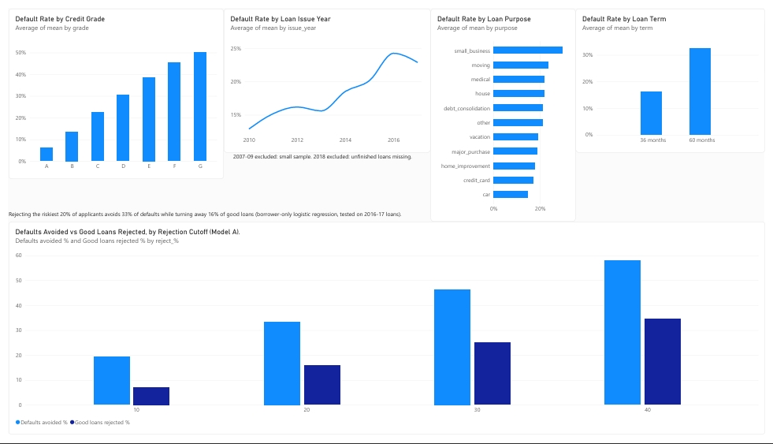

# Loan Default Analysis: Lending Club

Predicting which borrowers default, and what a bank should do about it, using SQL, Python and Power BI.

## Question
Banks lose money when borrowers don't repay their loans. I wanted to see if a borrower's application details can predict who will default, and how many defaults a bank could avoid by rejecting the riskiest applicants.
## Data
I used Lending Club's public loan data from Kaggle (https://www.kaggle.com/datasets/adarshsng/lending-club-loan-data-csv), covering loans from 2007 to 2018. About 1.3 million loans had a final result, and roughly 20% of them defaulted. I removed loans that were still being repaid because their outcome isn't known yet. The original file is over 1 GB, so I didn't upload it here.
## Method
- Target: Charged Off = 1, Fully Paid = 0
- Cleaning: DTI capped at 60, income capped at the 99th percentile, missing values filled with the median
- Time-based split: trained on loans issued up to 2015 (822,826), tested on 2016-17 (433,599). 2018 excluded.
- Models: logistic regression. Model A uses borrower features only; Model B adds Lending Club's grade, interest rate and installment.
- SQL (SQLite) used for grouping and bucketing analysis; see `queries.sql`.

## Key findings
- Default rate rises from 6.1% (grade A) to 50.1% (grade G)
- 60-month loans default at 32.6% vs 16.1% for 36-month loans
- Default rate is 29.5% for DTI above 30 vs 14.9% for DTI below 10
- Model A AUC: 0.665. Model B AUC: 0.698. Lending Club's own grade adds only about 3 AUC points over borrower features.

## Recommendation
Rejecting the riskiest 20% of applicants (Model A) lowers the approved-book default rate from 23.8% to 19.8%, avoids 33.4% of defaults, and turns away 15.8% of good loans.

## Limitations
- Counts loans, not dollars; no profit or loan-size weighting
- Right-censoring: loans from 2016-2018 that are still running are missing, which inflates the test-period default rate
- Logistic regression is a baseline; other models may perform better

## Files
- [loan_default_analysis.ipynb](loan_default_analysis.ipynb): full analysis
- [queries.sql](queries.sql): SQL queries
- [dashboard.pdf](dashboard.pdf) / [dashboard.jpeg](dashboard.jpeg): Power BI dashboard
- [cutoff_results.csv](cutoff_results.csv): rejection cutoff results
